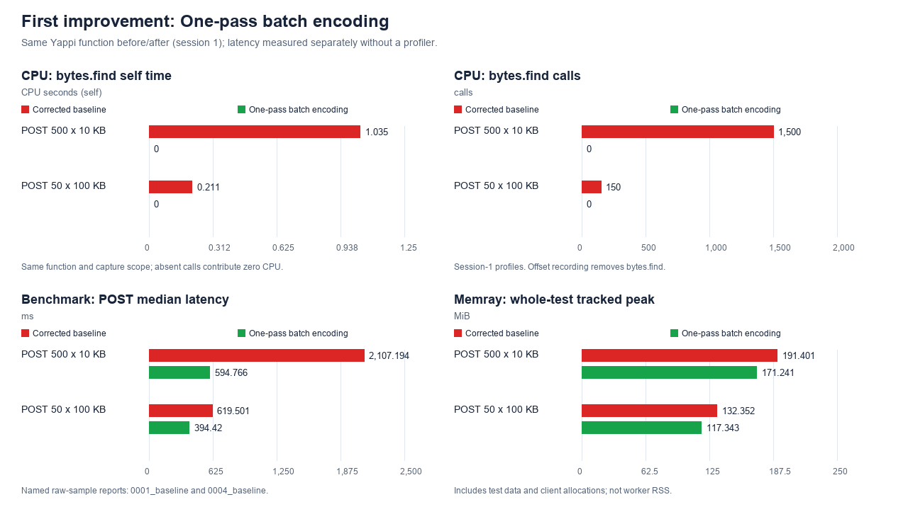
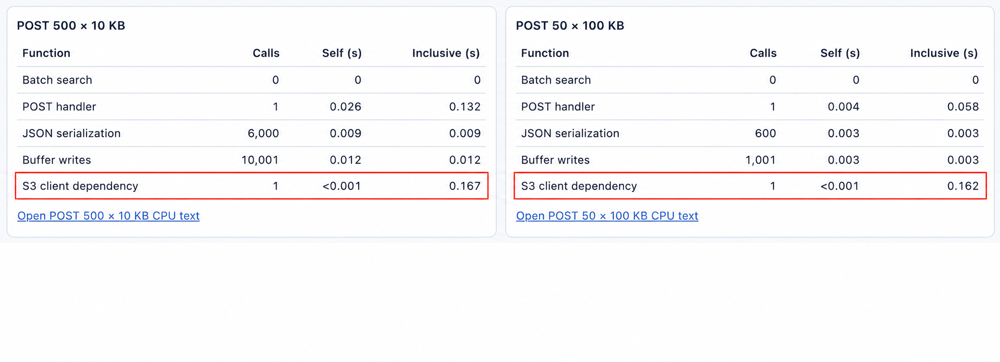
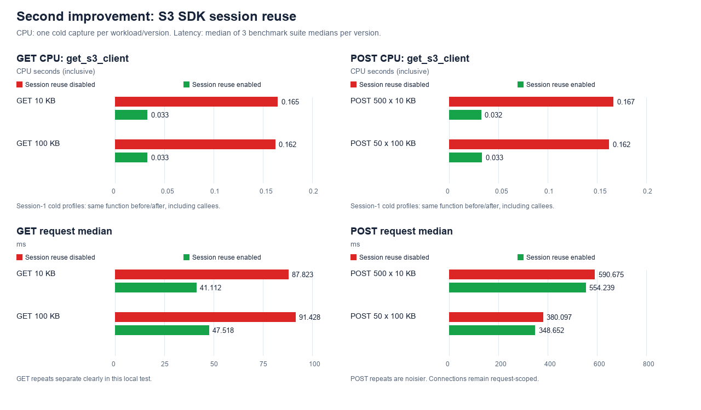
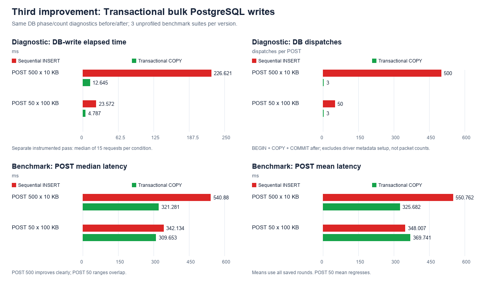
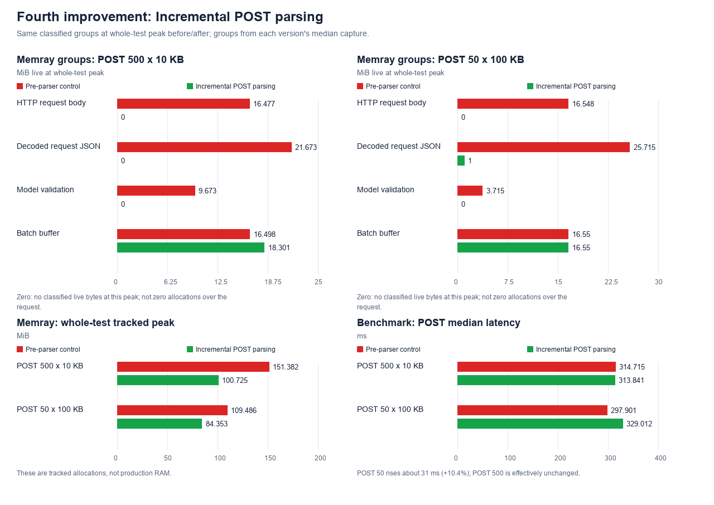
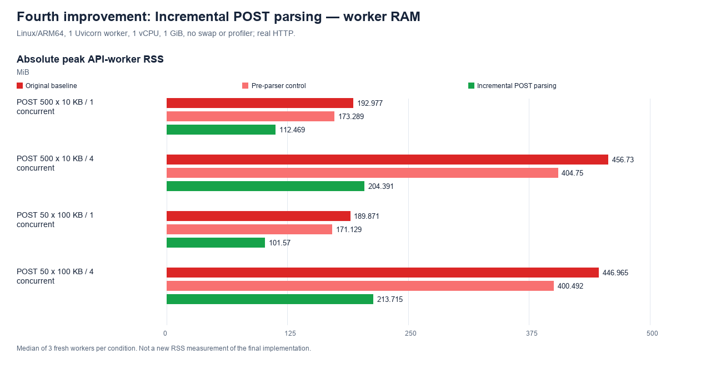
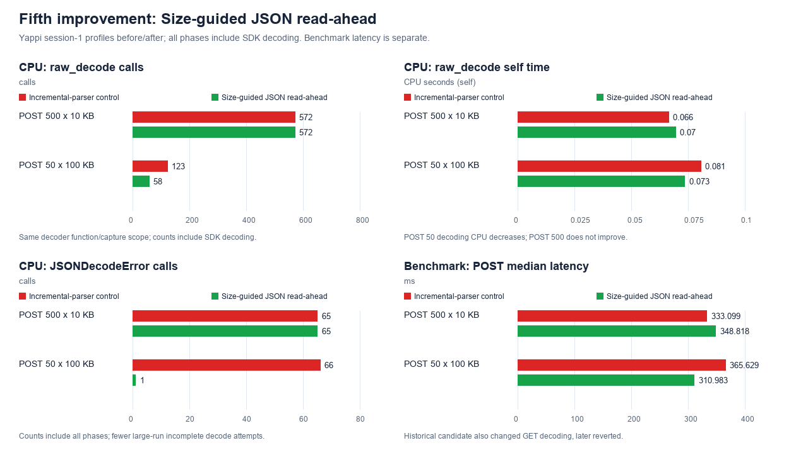

# Run handler optimization report

Profile-guided changes reduced POST and GET latency while lowering tracked
memory. The work stayed within the existing PostgreSQL/S3 storage design.

## Contents

- [Results](#1-results)
  - [Median request latency](#median-request-latency)
  - [Peak tracked allocations](#peak-tracked-allocations)
- [Approach](#2-approach)
- [Retained improvements](#3-retained-improvements)
  - [First: One-pass batch encoding](#first-improvement-one-pass-batch-encoding)
  - [Second: S3 SDK session reuse](#second-improvement-s3-sdk-session-reuse)
  - [Third: Transactional bulk PostgreSQL writes](#third-improvement-transactional-bulk-postgresql-writes)
  - [Fourth: Incremental POST parsing](#fourth-improvement-incremental-post-parsing)
  - [Fifth: Size-guided JSON read-ahead](#fifth-improvement-size-guided-json-read-ahead)
- [Other retained changes](#4-other-retained-changes)
- [Experiments not adopted](#5-experiments-not-adopted)
- [Limits and next steps](#6-limits-and-next-steps)
- [Reproduction and evidence](#7-reproduction-and-evidence)

## 1. Results

### Median request latency

| Workload | Baseline (ms) | Final (ms) | Reduction |
|---|---:|---:|---:|
| POST 500 × 10 KB | 2,107.2 | 358.9 | 83.0% |
| POST 50 × 100 KB | 619.5 | 343.1 | 44.6% |
| GET 10 KB | 88.2 | 43.1 | 51.1% |
| GET 100 KB | 95.2 | 46.9 | 50.7% |

### Peak tracked allocations

| Workload | Baseline (MiB) | Final (MiB) | Reduction |
|---|---:|---:|---:|
| POST 500 × 10 KB | 191.401 | 100.721 | 47.4% |
| POST 50 × 100 KB | 132.352 | 84.366 | 36.3% |
| GET 10 KB | 14.625 | 9.215 | 37.0% |
| GET 100 KB | 7.126 | 2.412 | 66.1% |

**Memray measures whole-test allocations, not production RAM.** GET captures
also include POST seeding. A separate real-worker RAM check is reported under
incremental parsing.

## 2. Approach

I read the code line by line, first for data flow and then for repeated work,
sequential calls and overlapping data in memory. I recorded these hypotheses in
a local experiment journal, then checked them against CPU and memory profiles
before choosing changes.

I expanded correctness coverage before collecting the baseline: exact round
trips, generated IDs, large fields, nested JSON/Unicode/escapes, empty defaults,
repeated contents, invalid input and missing storage. Later tests covered
session reuse, parallel clients and duplicate-ID rollback. The final
[application suite](tests/test_runs.py) groups
API behavior into four focused test functions with 10 test cases.
It checks returned values, rejected writes, rollback and storage failures
without asserting internal method-call counts. All 10 cases passed
against isolated PostgreSQL and object-storage resources after this cleanup.

**Correctness fix: failed GET retrievals must not return success.**
`GET /runs/{run_id}` finds the run in PostgreSQL, then reads its `inputs`,
`outputs` and `metadata` from S3. The missing-object test showed that the original
S3 helper caught read failures and returned `{}` instead of raising an error.
It also did this when stored JSON could not be decoded. The endpoint therefore
returned HTTP 200 with empty fields, hiding the failure as a successful read.

I changed these failures to return **503: `Stored run data is unavailable`**.
Invalid stored S3 references are also rejected instead of becoming empty fields.

| Status | Meaning |
|---|---|
| 200 | The run and its fields were retrieved successfully; genuinely empty fields are valid. |
| 404 | No run with that ID exists in PostgreSQL. |
| 503 | The run exists, but its referenced S3 data cannot be read or decoded. |

503 makes the backing-storage failure explicit; it does not guarantee that a
retry will fix it. A permanently missing object needs repair. The initial
missing-object fix was made before collecting the performance baseline and is
not counted as an optimization.

The experiment cycle was: **baseline, profile, hypothesis, focused change,
correctness check, remeasure, keep or revert**. I preserved the supplied timing
and Memray workflows, added Yappi CPU profiling and separate diagnostics, and
used a local dashboard to compare saved results. That local tooling and the
journal are excluded from the submission; the matched evidence remains in the
charts and [plotted-data manifest](reports/figures/data.json).

Each improvement below pairs the **same measured operation or allocation group
before and after**. CPU, memory and diagnostic evidence are shown separately
from unprofiled request latency, not substituted for one another.

## 3. Retained improvements

### First improvement: One-pass batch encoding

**Problem/source.** [Baseline Yappi evidence](reports/profiles/selected-cpu.json)
showed 1,500 `bytes.find()` calls costing 1.035 self-CPU seconds on POST 500:
three fields per run, repeatedly searched in the completed batch.

**Hypothesis.** Record offsets while encoding instead of searching afterwards.

**Change.** Write JSON into `BytesIO`; use `batch.tell()` and each encoded field's
length to record its start/end offsets. Keep the existing S3 format and schema.

**Matched CPU result.** In the same Yappi capture scope, `bytes.find()` self CPU
fell from 1.035 / 0.211 s to zero, and calls fell from 1,500 / 150 to zero.
Separately, POST median latency fell 71.8% / 36.3% for the two workloads.

**Trade-off/decision.** Retained. Small buffer writes cost less than the removed
searches in these workloads; correctness tests preserve the stored values.
[Before/after evidence](reports/figures/data.json).

### Second improvement: S3 SDK session reuse

**Problem/source.** After encoding improved, the
[CPU evidence](reports/profiles/selected-cpu.json) still showed
`get_s3_client()` taking 0.167 / 0.162 inclusive CPU seconds on the two POST
shapes. This includes its callees; it does not isolate session construction.

Highlighted CPU evidence

Before session reuse: S3 client setup remained a visible CPU cost. The graph
below pairs these same CPU rows with their after measurements.

**Hypothesis.** Reuse SDK setup, without sharing request-owned HTTP resources.

**Change.** Cache `get_s3_session()` with `lru_cache(maxsize=1)`. Each request
still creates and closes its own S3 client.

**Matched CPU result.** POST-500 dependency CPU fell from 0.166570 to 0.032299 s.
Separately, repeated GET medians fell from 87.8 to 41.1 ms and 91.4 to 47.5 ms
(53.2% / 48.0%). Three benchmark suites per version, with varied execution
order, supported a clear GET improvement; POST timing remained noisy.

**Trade-off/decision.** Retained session reuse, not connection pooling. Request
and connection counts did not change. Some SDK allocations move outside later
Memray captures, so they do not prove equal RAM savings. The session's benefit
was not re-isolated after the later GET changes.
[Before/after evidence](reports/figures/data.json).

### Third improvement: Transactional bulk PostgreSQL writes

**Problem/source.** [Diagnostics](reports/figures/data.json)
showed 500 sequential INSERT calls and a 226.6 ms database-write phase on POST 500.

**Hypothesis.** Batch the references to reduce sequential database exchanges.

**Change.** Use `copy_records_to_table()` inside `db.transaction()`, with the
existing columns and response-ID order.

**Matched diagnostic result.** Database-write time fell from 226.6 to 12.6 ms
on POST 500 and 23.6 to 4.8 ms on POST 50. Measured dispatches fell from 500 / 50
to BEGIN, COPY and COMMIT—three dispatches, not three network packets.
POST-500 median latency fell 40.6%; all three after-suite medians were below
all three controls. POST-50 median fell 9.5%, but its mean **rose 6.2%**;
separate investigations found upload stalls in both versions.

**Trade-off/decision.** Retained for large-batch latency and database atomicity,
not memory savings. Duplicate IDs roll back the batch, but an earlier successful
S3 upload can remain orphaned; no cross-store transaction is claimed.

### Fourth improvement: Incremental POST parsing

**Problem/source.** The [fresh pre-parser Memray control](reports/figures/data.json)
showed POST-500 allocations overlapping at peak: raw body 16.5 MiB, decoded JSON
21.7 MiB, model validation 9.7 MiB and outgoing batch 16.5 MiB.

**Hypothesis.** Validate and encode one run at a time, then release its decoded
data/model instead of retaining the complete input list.

**Change.** Incrementally decode array items with a 256 KiB maximum input chunk,
validate each Run and append it to the outgoing batch. Storage writes begin
only after all input is valid.

**Matched memory result.** At the after-capture peak, body/model groups were
absent and decoded-JSON contributions fell from 21.7 to 0 MiB (POST 500) and
25.7 to 1 MiB (POST 50). The outgoing buffer remained. Zero means no classified
live bytes at that peak, not that those operations never allocated memory.
Both versions use the same grouping rules.

Whole-test tracked peaks fell 33.5% / 23.0% against fresh controls.
POST-500 latency was effectively unchanged; POST-50 rose from 297.9 to
329.0 ms (**10.4%, about 31 ms**). Repeated attempts to decode incomplete
large runs added CPU work.

**Trade-off/decision.** Retained for substantial memory savings, accepting the
measured latency cost. This is not constant-memory ingestion: the outgoing
batch and a complete individual run still need RAM. Chunk size is not a
request-size limit. A production latency SLO could require a different decision.

**Actual server RAM check.** In an assumed Linux/ARM64 environment—one persistent
Uvicorn worker, 1 vCPU, 1 GiB RAM, real HTTP, no profiler—peak worker RSS fell
41.7% / 46.5% versus the original at concurrency 1, and 55.2% / 52.2% at
concurrency 4. Values are medians of three fresh workers per case. This check
predates the final read-ahead change; it is not a guarantee for an unknown
production deployment or an RSS measurement of the exact final code.

Worker-RAM graph and evidence

[Parser and RAM evidence](reports/figures/data.json).

### Fifth improvement: Size-guided JSON read-ahead

**Problem/source.** The [POST-50 CPU evidence](reports/profiles/selected-cpu.json)
contained 123 `raw_decode` calls and 66 JSON-error constructions. These include
SDK decoding, but the parser also retried incomplete values.

**Hypothesis.** Use the preceding large run's length to avoid trying the next
decode too early.

**Change.** Read toward that length when it exceeds 256K characters, with a
512K-character hint cap. Input chunks still have a 256 KiB maximum.

**Matched CPU result.** POST-50 `raw_decode` calls fell from 123 to 58,
self CPU from 0.080644 to 0.073476 s, and JSON-error constructions from 66 to 1.
These are session-1, all-phase profiles in both versions, including SDK decoding.
POST-500 call counts did not improve. Separately, POST-50 median latency fell
14.9% against its fresh control; POST-500 median **rose 4.7%**. Tracked peaks
stayed effectively unchanged.

**Trade-off/decision.** Retained the bounded, dependency-free adjustment, not a
claim that parsing's latency penalty is solved. The historical candidate also
changed GET decoding, which was later reverted; all four workloads were rerun
on the exact final code. Different controls mean the 14.9% gain cannot be
subtracted from the earlier 10.4% penalty.
[Experiment evidence](reports/figures/data.json).

## 4. Other retained changes

These remain in the code, separate from the five measured improvements above.

| Change | Evidence and boundary |
|---|---|
| [Single-range GET](reports/figures/data.json) | Reduced S3 reads and observed new TCP connections from three to one per retrieval. The original reads were concurrent. No clear latency/memory win; legacy different-object references keep the concurrent fallback, and combined ranges can download intervening bytes. |
| [Direct JSON response](reports/figures/data.json) | Explicit `ORJSONResponse` removed 6,157 recursive `jsonable_encoder` calls on GET-100. Its repeated median fell 10.6%; GET-10 latency and GET-100 tracked memory were effectively unchanged. Retained as cleanup; output must remain JSON-compatible. POST also keeps a direct HTTP 201 response without a separate speedup claim. |
| Runtime observability | JSON logs record a generated request ID, method, route template, HTTP status and elapsed milliseconds. Storage failures include operation, object/run context and error type with the same ID. Handled responses return `X-Request-ID`. Bodies pass through unchanged; payloads, credentials and raw exception messages are not logged. No performance benefit is claimed. |

## 5. Experiments not adopted

These changes were tested but not kept; applied candidates were reverted and
isolated prototypes were never added to the application. The recordings remain archived
locally; the submission retains the results and [chart values](reports/figures/data.json).

| Experiment / what changed | Measured outcome | Why I did not keep it |
|---|---|---|
| **Disk spooling.** Built the outgoing S3 batch in a temporary file: keep up to 1 MiB in RAM, spill larger batches to disk, then upload the file directly. | About 5% lower tracked POST peaks; latency 8.6–11.7% higher | The memory saving was small while both POST medians increased. Larger batches also required temporary disk space and file cleanup. I accepted the roughly 5% higher tracked peak to keep uploads in memory and avoid that latency/resource trade-off. |
| **Whole-body Pydantic parsing.** Passed the complete raw POST body to `TypeAdapter.validate_json()`, combining JSON decoding and model validation instead of first building a separate Python list. All Run models still existed together. | About 3.5% lower tracked peaks; mixed latency | It removed an intermediate representation, but not the full body or all the models—the main memory overlap remained. Preserving unusual encodings, deeply nested JSON and validation errors needed fallback paths. The modest saving and inconsistent latency gain did not justify maintaining those paths. |
| **Earlier model release.** Removed each Run model from the already-parsed list after encoding it, allowing models to be freed while the outgoing S3 batch grew. This did not stream the incoming request. | 2.5–3.8% lower tracked peaks; POST-50 at concurrency 4 saved no RAM, with p95 36.3% higher | POST-50 saved 13.2% worker RSS with two clients, but that benefit did not hold with four; throughput also fell 10.4% there. I gave up the narrow two-client benefit rather than keep list-mutation/release logic with a worse higher-concurrency trade-off. |
| **Raw-field iteration.** Fed field/value pairs directly from each Run model into the encoder rather than creating a dictionary with `model_dump()`. | Under 0.03% tracked-memory gain; mixed timing | The temporary dictionaries were not a meaningful part of the memory peak. Removing them produced no clear request-latency win, so I kept Pydantic's standard serialization path rather than a custom field-iteration path for negligible savings. |
| **Larger parser chunks.** Raised the maximum parsing chunk from 256 KiB to 512 KiB or 1 MiB, hoping to decode large runs in fewer attempts. | Some faster POST-50 timings; 1 MiB raised single-request RSS | Raising a maximum does not make small network fragments arrive together, so repeated parsing persisted under fragmented input. Real-HTTP timings were mixed and 1 MiB increased RAM, working against the memory goal. I kept the 256 KiB maximum; bounded read-ahead was evaluated separately. |
| **`ijson` parser.** Tried an incremental parsing library that continues through incoming chunks instead of restarting `raw_decode()` when a run is incomplete. Added numeric-conversion fixes to preserve existing values. | Passed 418/421 compatibility checks after numeric fixes; mixed latency and higher RAM | Less parsing CPU did not translate into a consistent end-to-end latency win. NaN/Infinity and unpaired-Unicode-surrogate behavior still differed from the existing parser, and worker RAM increased. I rejected the dependency rather than change accepted input behavior for an uncertain speedup. |
| **JSON boundary scanners.** Scanned for complete run boundaries before decoding, rather than using failed decode attempts to detect incomplete input. | Both prototypes were slower in local CPU checks | Scanning added work before the JSON still had to be decoded. In these prototypes, avoiding failed decode attempts did not offset that cost. I stopped at the local checks rather than add another parser component without a CPU benefit. |
| **Full-run reference migration.** Added a database reference to the whole run's S3 byte range, allowing GET to decode one run object instead of three fields. Kept a fallback for older field references. | Three JSON decodes became one; no demonstrated GET latency gain | GET already used one S3 read, and still had to decode the same data. Fewer decoder calls did not make retrieval measurably faster. The modest POST CPU benefit did not justify a new column, old-data backfill and two reference formats to support during rollout. |
| **Replacement GET decoder.** Used Python's `json.loads()` instead of `orjson.loads()` for retrieved S3 fields, with compatibility handling, to reduce decoder allocations. | GET-10 tracked peak fell 86.9%, but worker RSS fell only 1.89–2.18 MiB; timing was small/mixed | The large profiler reduction was not an equivalent RAM reduction: real worker savings were only about 2–2.6%. Keeping the replacement required numeric/Unicode compatibility code without a consistent latency benefit. I accepted the roughly 2 MiB cost and restored `orjson.loads()`. |

## 6. Limits and next steps

Measurements ran on Apple M1/macOS, Python 3.11.9, PostgreSQL/MinIO in Docker.
The supplied benchmark creates a new event loop per timed execution. Later
comparisons generally used three suites per version with varied execution order.

- **No production-capacity claim:** small samples, one original baseline suite
  and local variability do not establish production p95/p99 or throughput.
- **Keep scopes separate:** inclusive CPU can overlap and includes profiler
  overhead; unprofiled latency, Memray peaks and OS-reported RSS are different
  measurements. Lower GET test peaks do not prove equal standalone GET RAM gains.
- **Evidence availability:** charts, plotted values, raw baseline/final timing
  samples and compact profiler extracts are included; full profiler recordings
  and detailed historical interpretations remain local.
- **Observability boundary:** request logs are not distributed tracing or a
  metrics backend. Unhandled errors are logged as 500, but their outer framework
  error response does not receive the middleware's request-ID header.

| Future improvement—not implemented | What would justify adopting it |
|---|---|
| Application-lifetime S3 client and bounded DB pool | Lower setup latency/connections under persistent-loop real HTTP, with timeout, failure/recovery and shutdown tests. Current clients/connections remain request-scoped. |
| Reduce incomplete parsing; bound request/run sizes and buffer memory | Better POST latency without losing compatibility or peak-RSS savings. The current service has no configured request/run-size limit. |
| Orphan cleanup and retry/idempotency handling | Recover safely when PostgreSQL fails after S3 upload, without deleting valid objects. |
| Sustained deployment-specific load tests | Stable RSS, error rate, p95/p99 and throughput at the intended worker count/concurrency. |

## 7. Reproduction and evidence

Start storage with `make db-up`. These commands reset dedicated test resources;
do not run them alongside other writers.

| Command | Measurement / saved output |
|---|---|
| `make test` | Correctness tests, excluding benchmarks |
| `make benchmark` | Original four unprofiled workloads and raw timing samples → `.benchmarks/` |
| `make memprofile` | Original Memray workflow → `profiles/memory/<run>/` |

Final verification at `caf9bdc`: **10 passing application tests**, three original
unprofiled benchmark suites and three Memray suites (12 memory captures), with
request logging enabled. Ruff lint and formatting checks passed. Benchmark
fixtures and timing options were unchanged; verification used a disposable
database/bucket per suite instead of resetting shared test resources.

The results compare one baseline suite at `bdf1239` (after the correctness fix,
before optimization) with medians of three final suites/captures per workload.
Fresh final timings were slower than the earlier capture; POST-50 suite medians
ranged from 333.8 to 463.6 ms. All repeats are included, not just the fastest.
This remeasurement does not isolate logging overhead from local variability.

Included evidence: [baseline timing samples](reports/benchmarks/baseline.json),
final timing samples [1](reports/benchmarks/final-1.json),
[2](reports/benchmarks/final-2.json), [3](reports/benchmarks/final-3.json),
[baseline Memray peaks](reports/profiles/baseline-memory.json),
[final Memray peaks](reports/profiles/final-memory.json) and
[selected historical Yappi rows](reports/profiles/selected-cpu.json).
The CPU rows explain earlier experiments; they were not rerun after request
logging. The historical CPU/diagnostic harness and dashboard remain local.

[Final evidence](reports/benchmark-results.json) records the measured application
fingerprint, baseline/final values and repeats. [Figure data](reports/figures/data.json)
contains exact before/after chart values, samples and provenance hashes. Source
paths identify archived originals; hashes do not reconstruct missing recordings.

Charts are included as PNG files, so reviewing the report does not require
the dashboard. Red shows baseline/control and green the changed version; values,
not colors, determine whether a result improved.
