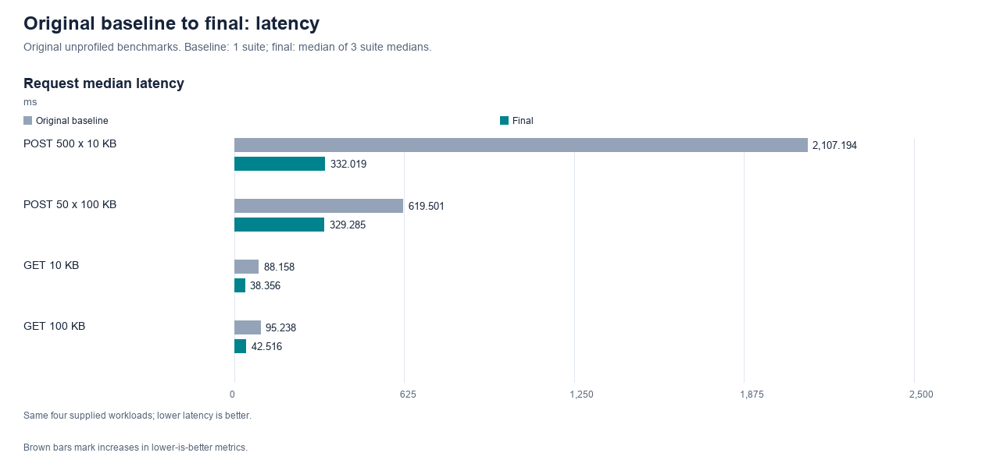
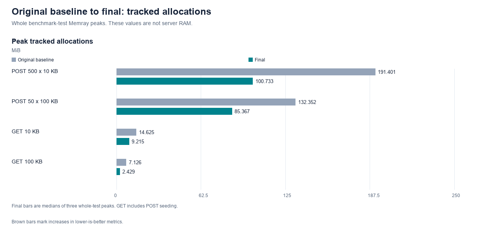
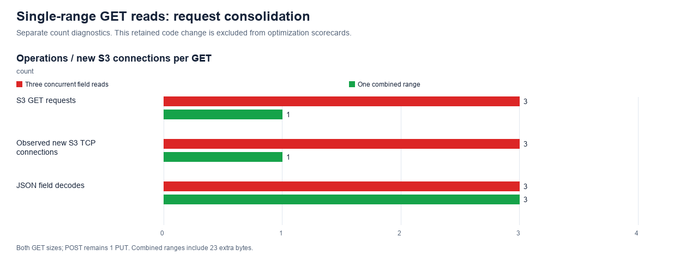
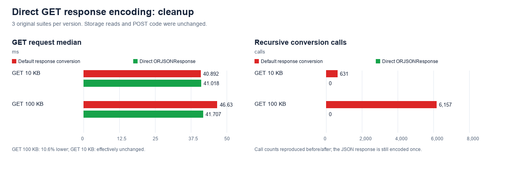

# Run ingestion optimization — submission draft

Draft for review · 5 October 2026. This document describes the measured final
implementation.

## Table of contents

- [1. The result, in brief](#1-the-result-in-brief)
  - [Final latency](#final-latency)
  - [Final tracked memory](#final-tracked-memory)
- [2. Approach and evaluation](#2-approach-and-evaluation)
- [3. First improvement: One-pass batch encoding](#3-first-improvement-one-pass-batch-encoding)
- [4. Second improvement: S3 SDK session reuse](#4-second-improvement-s3-sdk-session-reuse)
- [5. Third improvement: Transactional bulk PostgreSQL writes](#5-third-improvement-transactional-bulk-postgresql-writes)
- [6. Fourth improvement: Incremental POST parsing](#6-fourth-improvement-incremental-post-parsing)
  - [Why memory became the focus](#why-memory-became-the-focus)
  - [What changed](#what-changed)
  - [Measured benefit and accepted cost](#measured-benefit-and-accepted-cost)
  - [Separate real-RAM check](#separate-real-ram-check)
  - [Why latency increased, and why I kept the parser](#why-latency-increased-and-why-i-kept-the-parser)
- [7. Fifth improvement: Size-guided JSON read-ahead](#7-fifth-improvement-size-guided-json-read-ahead)
- [8. Other retained changes—not counted as optimization wins](#8-other-retained-changesnot-counted-as-optimization-wins)
  - [Single-range GET reads: request consolidation](#single-range-get-reads-request-consolidation)
  - [Direct GET response encoding: cleanup](#direct-get-response-encoding-cleanup)
- [9. Experiments I tested and did not keep](#9-experiments-i-tested-and-did-not-keep)
- [10. How strong are the claims?](#10-how-strong-are-the-claims)
  - [Remaining production concerns](#remaining-production-concerns)
  - [Future improvements I would test—not implemented](#future-improvements-i-would-testnot-implemented)
- [11. Final verification and evidence](#11-final-verification-and-evidence)
  - [Commands and submission evidence](#commands-and-submission-evidence)
- [Closing explanation](#closing-explanation)
- [Appendix: test coverage and measurement setup](#appendix-test-coverage-and-measurement-setup)
  - [Correctness coverage](#correctness-coverage)
  - [Measurement setup](#measurement-setup)

## 1. The result, in brief

I approached this as a sequence of experiments: protect correctness, measure the
starting point, locate expensive work, change one part, and measure again.
I kept useful changes and reverted experiments whose benefits did not justify
their regressions or maintenance cost.

The largest improvements came from:

- Recording field offsets while writing the S3 batch, instead of searching the
  completed batch repeatedly.
- Reusing SDK session setup, while keeping S3 clients request-scoped.
- Replacing sequential PostgreSQL INSERTs with transactional binary COPY.
- Parsing and encoding one run at a time, so the entire decoded request and all
  validated models do not have to coexist in memory.
- Adding bounded read-ahead for large runs to reduce repeated parsing of
  incomplete JSON values.

A final bounded read-ahead adjustment reduced repeated parsing of large runs.
It helped the larger-field POST in its experiment, but was not a uniform
latency improvement.

### Final latency

| Supplied workload | Corrected baseline | Final | Observed reduction |
|---|---:|---:|---:|
| POST 500 runs × 10 KB per field | 2,107.2 ms | 332.0 ms | 84.2% |
| POST 50 runs × 100 KB per field | 619.5 ms | 329.3 ms | 46.8% |
| GET one run × 10 KB per field | 88.2 ms | 38.4 ms | 56.5% |
| GET one run × 100 KB per field | 95.2 ms | 42.5 ms | 55.4% |

The baseline is **one saved benchmark suite**. Final values are the median
of three suite medians from the final benchmark run.
These are observed cumulative improvements, not statistically established
production percentages or a breakdown of how much each change contributed.

### Final tracked memory

| Supplied workload | Corrected baseline | Final | Observed reduction |
|---|---:|---:|---:|
| POST 500 × 10 KB | 191.401 MiB | 100.733 MiB | 47.4% |
| POST 50 × 100 KB | 132.352 MiB | 85.367 MiB | 35.5% |
| GET 10 KB | 14.625 MiB | 9.215 MiB | 37.0% |
| GET 100 KB | 7.126 MiB | 2.429 MiB | 65.9% |

These are **whole-test Memray allocation peaks, not production RAM**. The final
values are medians of three captures. I separately measured real API-worker RAM
in an assumed Linux deployment for the incremental-parser experiment; those
results appear in section 6 and must not be mixed into this table.

These results reflect the final implementation, excluding reverted experiments.

## 2. Approach and evaluation

I read the code line by line: first to understand the data flow, then to look
for repeated work, sequential storage calls and overlapping payloads in memory.
This suggested possible bottlenecks, but I wanted profiling evidence before
choosing an optimization.

I used a local experiment journal to record each
hypothesis, expected outcome, before/after measurements and the decision to
keep or revert it. I kept the supplied benchmarks and Memray workflow, added
Yappi CPU profiling and a detachable diagnostic harness, and saved reports for
comparison in a local dashboard. That tooling and its detailed experiment history
are preserved locally and excluded from this submission. The supplied benchmark
and memory commands remain available.

Before measuring the baseline, I expanded correctness coverage so a faster
implementation could not silently change API behavior or stored values. I
strengthened the existing create/retrieve test to compare complete responses,
including IDs and input order, and added these cases:

| Added test cases | Why |
|---|---|
| Generated IDs | Ensure omitted IDs produce unique, retrievable runs |
| Large fields | Detect truncation or incorrect ranges for roughly 100 KB fields |
| Nested JSON, Unicode, escapes and numeric values | Preserve exact values through encoding, storage and parsing |
| Empty and omitted fields | Preserve the API's existing defaults |
| Repeated field contents | Ensure identical values within/across runs have correct references |
| Invalid requests and missing runs | Check rejection/status behavior and prevent writes for invalid input; later extended to verify duplicate-ID rollback |
| Missing S3 object | Return a visible storage error instead of a successful response with empty fields |

The missing-object test exposed HTTP 200 with empty fields; I changed that to
503. I then collected baseline benchmarks and CPU/memory profiles at `bdf1239`,
before performance changes. Later, I added two SDK-session tests for reuse and
parallel requests, checking that clients remained request-scoped. The final
application suite contains ten named tests.

The evaluation commands were:

| Command | What it does |
|---|---|
| `make test` | Run correctness tests, excluding benchmarks |
| `make benchmark` | Run the original four workloads without a profiler and save latency results/raw samples |
| `make memprofile` | Run those workloads with Memray to capture allocation sources and tracked peaks—not server RAM |

PostgreSQL and MinIO must be running (`make db-up`). `make test`,
`make benchmark` and `make memprofile` reset the dedicated test database/bucket;
run them without other writers to those resources. The historical CPU profiling
harness used isolated temporary resources and cleaned them up; it is not
included in this submission.

For each experiment, I followed the same cycle:

1. Inspect the profiles and choose the largest relevant request-path bottleneck.
2. Define a focused change and its expected effect.
3. Implement it and run correctness tests.
4. Repeat benchmarks, profiles and relevant diagnostics against the control.
5. Record gains, regressions and trade-offs; keep or revert the change.

I used each result to choose the next experiment. Later, I checked actual worker
RAM separately rather than interpreting Memray savings as production RAM.
[The appendix](#appendix-test-coverage-and-measurement-setup) records the test
coverage and measurement details.

## 3. First improvement: One-pass batch encoding

**Problem found.** Repeated full-batch searches were the main POST CPU hotspot.
The baseline reports showed:

| Report | Measured work / allocation | POST 500 × 10 KB | POST 50 × 100 KB |
|---|---|---:|---:|
| Yappi CPU profile | `bytes.find` calls | 1,500 | 150 |
| Yappi CPU profile | `bytes.find` self CPU | 1.034662 s | 0.211245 s |
| Memray memory profile | Full-batch serialization allocations at peak | 32.000 MiB | 32.000 MiB |
| Memray memory profile | Run-dictionary construction allocations at peak | 5.673 MiB | 3.715 MiB |

**Source.** Baseline CPU and memory recordings and their hashes are archived
locally. CPU rows are from one cold capture per workload; memory rows are live
allocation groups at the whole-test peak, not server RAM.

The code explained the 1,500 searches: three fields × 500 runs, each searched
in the completed batch. CPU evidence identified the search cost; Memray
separately showed intermediate representations that could be avoided.

**Hypothesis.** If I know where a field starts while writing it, I do not need
to search for its position afterwards. This should reduce POST CPU, latency and
some intermediate allocations. It should not improve GET directly.

**Change.** Write JSON into `BytesIO` incrementally. Before writing a field's
encoded value, record `batch.tell()`; its end is that position plus its encoded
byte length. Store those exact offsets using the existing S3-reference format.
The object remains a JSON array and the database schema remains unchanged.

**POST 500 runs × 10 KB per field**

| Measurement | Before | After | Reduction |
|---|---:|---:|---:|
| Median request latency (ms) | 2,107.2 | 594.8 | 71.8% |
| Cold first-request CPU (s) | 1.771 | 0.725 | 59.1% |
| Whole-test tracked peak (MiB) | 191.401 | 171.241 | 10.5% |
| Full-batch searches | 1,500 | 0 | 100% |

**POST 50 runs × 100 KB per field**

| Measurement | Before | After | Reduction |
|---|---:|---:|---:|
| Median request latency (ms) | 619.5 | 394.4 | 36.3% |
| Cold first-request CPU (s) | 0.777 | 0.547 | 29.6% |
| Whole-test tracked peak (MiB) | 132.352 | 117.343 | 11.3% |
| Full-batch searches | 150 | 0 | 100% |

**Why I attribute the improvement to this change.** Recording offsets during
encoding eliminated the repeated `bytes.find()` searches across the completed
batch. The CPU profiles confirm that these calls fell from 1,500 to zero for
POST 500 and from 150 to zero for POST 50. Correctness tests still retrieve the
same data, while measured POST latency and CPU both decrease. This links the
improvement to removal of the measured search work, rather than relying only
on a faster benchmark.

**Code trade-off.** Small buffer writes replace the repeated `bytes.find()`
searches. Their added overhead was outweighed by the search savings: cold
first-request CPU fell 59.1% for POST 500 and 29.6% for POST 50. I kept this
trade-off because it reduced total CPU and latency while preserving correctness.

**Decision: retained.** The mechanism and substantial measured change justify
the extra offset-recording logic without a schema migration.

Evidence: one-pass interpretation (archived locally).

## 4. Second improvement: S3 SDK session reuse

**Problem found.** After one-pass encoding, SDK setup remained a visible cost:

*After removing batch searches, S3 client setup remained a visible CPU cost.*

Memray also attributed 43.043 MiB (POST 500) and 26.917 MiB (POST 50) at peak
to S3 SDK / data allocations.

**Source.** one-pass CPU and memory tables (archived locally).
The CPU row includes the dependency's callees; the memory group includes SDK
data handling, not just session construction. These measurements do not isolate
the cost of `get_session()`.

**Hypothesis.** Reusing the SDK session could avoid repeated setup work and
reduce CPU and latency for both POST and GET. Clients would remain
request-scoped, so this would not reuse network connections.

**Change.** Cache `get_s3_session()` with `lru_cache(maxsize=1)` and use it from
startup and the request dependency. Every request still creates an S3 client
inside its own async context manager and closes it afterwards.

A session is the SDK's setup/configuration object. A client is the service
interface that owns HTTP resources. Reusing the former is **not** reusing the
latter's connections.

**Why stop at session reuse?** It isolates a small change without introducing
shared connection lifetime, shutdown/recovery handling or a client tied to an
event loop. The supplied benchmark changes event loops between executions.
An application-lifetime client is a different experiment and was deferred.

**CPU results: the same S3 client dependency before and after.**

| Workload | CPU before reuse (s) | CPU after reuse (s) | Observed reduction |
|---|---:|---:|---:|
| POST 500 × 10 KB | 0.166570 | 0.032299 | 80.6% |
| POST 50 × 100 KB | 0.161998 | 0.033313 | 79.4% |
| GET 10 KB | 0.164797 | 0.032747 | 80.1% |
| GET 100 KB | 0.162442 | 0.032676 | 79.9% |

Both columns measure inclusive CPU time in `get_s3_client()`, including its
callees. These are session-1 cold-profile observations, not whole-request CPU
or elapsed request time. Sources: before reuse (archived locally)
and after reuse (archived locally).

**Latency results: the complete API request before and after.**

I ran three benchmark suites with session reuse enabled and three with it
disabled, varying the execution order. The table shows the median of the three
suite medians for each version. These unprofiled elapsed times include parsing,
storage waits and response handling—not just S3 setup CPU.

| Workload | Latency before reuse (ms) | Latency after reuse (ms) | Interpretation |
|---|---:|---:|---|
| POST 500 × 10 KB | 590.7 | 554.2 | 6.2% lower median; noisy repeats |
| POST 50 × 100 KB | 380.1 | 348.7 | 8.3% lower median; noisy repeats |
| GET 10 KB | 87.8 | 41.1 | 53.2% lower; separated repeat ranges |
| GET 100 KB | 91.4 | 47.5 | 48.0% lower; separated repeat ranges |

**Interpretation.** The profiles show less CPU work in the S3 client dependency.
The separate benchmarks show a clear GET latency improvement, but the POST
results are noisy. Lower dependency CPU does not imply the same percentage
reduction in complete request latency.

**Correctness and connection counts.** Tests verify that only the session is
reused, including parallel requests. Diagnostics show no reduction in storage
request or connection counts: POST remains one S3 PUT/new connection; GET
remained three reads/new connections at this stage.

**Limits.** Some SDK allocations move to startup or an earlier test, outside a
later Memray capture. Lower tracked peaks therefore do not establish equal
full-process RAM savings. The A/B result predates the one-range GET change; I
did not re-isolate the session's contribution after that read path changed.
GET's larger relative benefit is consistent with setup being a larger share of
its shorter request, but does not establish that “three reads” alone caused it.

**Decision: retained.** Repeated GET results support the benefit in this setup.
I do not claim a precise POST speedup or connection-pooling benefit.

Evidence: SDK-session interpretation (archived locally)
and the six explicitly identified on/off source reports in
[figure data](reports/figures/data.json).

## 5. Third improvement: Transactional bulk PostgreSQL writes

**Problem found.** The separate diagnostic pass exposed sequential database work
that CPU profiling alone could not quantify as elapsed waiting time:

| Diagnostic measurement before COPY | POST 500 × 10 KB | POST 50 × 100 KB |
|---|---:|---:|
| INSERT calls per request | 500 | 50 |
| Median database-write elapsed time | 226.621 ms | 23.572 ms |

**Source.** COPY evidence (archived locally),
`before-diagnostic`: 15 measured requests per workload across three sessions.
These are instrumented phase timings, not Yappi CPU seconds or the original
benchmark's request latency.

**Hypothesis.** Send the references together rather than await one insertion per
run. This should reduce database exchanges and help the many-run POST most.
It should not materially reduce the payload's memory or change GET.

**Change.** Use `copy_records_to_table()` inside `db.transaction()`. The binary
COPY writes the existing columns. No migration, S3-format change or connection
pool is involved. Response IDs retain input order.

| Measurement | POST 500: before → after | POST 50: before → after |
|---|---:|---:|
| Median request latency | 540.9 → 321.3 ms | 342.1 → 309.7 ms |
| Mean over saved rounds | 550.8 → 325.7 ms | 348.0 → 369.7 ms |
| DB-write elapsed phase | 226.6 → 12.6 ms | 23.6 → 4.8 ms |
| Measured DB dispatches | 500 → 3 | 50 → 3 |
| Cold first-request CPU | 0.596 → 0.469 s | 0.409 → 0.401 s |
| Whole-test tracked peak | 151.393 → 151.393 MiB | 110.486 → 110.486 MiB |

The three dispatches are **BEGIN + COPY + COMMIT**, not one total SQL command
or three network packets. Driver metadata preparation is outside that diagnostic
count. The phase measurements are a separate instrumented pass, not benchmark
latency.

**Why attribution is credible.** Only the insertion path changed. The measured
database phase became much shorter and every POST-500 after-suite median was
below every before-suite median: **309.9–340.8 versus 526.0–555.8 ms**.
That supports the 40.6% large-batch median reduction.

**Regression investigated.** POST-50's median fell, but its mean rose **6.2%**.
Its saved samples include a 1,011 ms request. Further instrumented investigations
found large upload pauses in both versions and no S3 retries. For example, one
771.7 ms request spent **636.5 ms uploading**, **10.3 ms writing the database**,
and **0.3 ms in GC**. COPY cannot remove an S3 upload stall. The precise MinIO
storage versus Docker/network cause remains unconfirmed; I do not claim COPY
caused or solved every tail event.

**Correctness and side effects.** Duplicate IDs roll back all rows in the batch;
existing rows survive and later writes succeed. That is database atomicity only:
S3 is uploaded first, so a database failure can leave an orphaned S3 object.
Duplicate-ID responses retain the existing 500 behavior. Cleanup/idempotency
across the two stores was not implemented and is not claimed.

**Decision: retained**, for the clear POST-500 benefit and atomic database writes.
No meaningful memory gain or uniform POST-50/tail improvement is claimed.

Evidence: COPY interpretation (archived locally).
The local experiment logbook also records the separate upload-tail
investigation and its local evidence paths.

## 6. Fourth improvement: Incremental POST parsing

### Why memory became the focus

**Problem found.** After bulk database writes, Memray still showed multiple
payload representations alive at the test peak:

| Memray allocation group after COPY | POST 500 × 10 KB | POST 50 × 100 KB |
|---|---:|---:|
| HTTP request body | 16.477 MiB | 16.548 MiB |
| Decoded request JSON | 22.673 MiB | 26.715 MiB |
| Model validation | 9.673 MiB | 3.715 MiB |
| Outgoing batch buffer | 16.498 MiB | 16.550 MiB |

**Source.** post-COPY memory breakdown (archived locally).
These are selected groups from the same whole-test peak, not the complete
allocation total or worker RSS. They showed why input decoding/model lifetime
was worth testing, even after latency improved.

I first tried smaller copying/lifetime changes. Their modest or inconsistent
benefits are recorded in section 9.

**Hypothesis.** Parsing, validating and encoding one run at a time should allow
its decoded data and model to be released before processing the next run. This
should reduce POST peak memory without changing the storage format or GET.
Incremental parsing could add CPU work, so POST latency must also be checked.

### What changed

**Change.** The request dependency now:

1. Reads incoming text in chunks, with a **256 KiB maximum chunk size**.
2. Decodes the next array item with the standard JSON decoder.
3. Validates it with the existing Run model.
4. Encodes it into the existing outgoing batch and records its offsets.
5. Releases that decoded run/model, retaining only batch bytes and small
   database records/response IDs.

Storage is acquired/written only after parsing and validation complete. A late
invalid run therefore does not persist the earlier valid runs.

This is **incremental request preparation, not constant-memory ingestion**.
The outgoing batch, database records, validation errors and some receive data
still occupy memory. A single very large run must still fit in the decoder;
the 256 KiB chunk size is not a request-size or RAM limit. An ASGI server/client
may also already hold a larger incoming chunk.

### Measured benefit and accepted cost

Fresh paired controls were used; these are not comparisons with the original
2-second POST baseline.

| Workload | Tracked peak before → after | Reduction vs control | Median latency before → after |
|---|---:|---:|---:|
| POST 500 × 10 KB | 151.382 → 100.725 MiB | 33.5% | 314.7 → 313.8 ms; effectively unchanged |
| POST 50 × 100 KB | 109.486 → 84.353 MiB | 23.0% | 297.9 → 329.0 ms; **10.4% higher** |

Both workloads exceeded the target of **25% lower tracked peaks versus the
original baseline**: 47.4% and 36.3% in this experiment. The later final
capture gives 47.4% and 35.5%; these are different named captures, not a revised
calculation of the same result.

**Why this is more than a correlation.** The changed path no longer builds the
complete decoded/model list. Paired captures show substantially lower allocation
peaks with correct output. I then tested whether that translated into real
worker RAM, rather than assuming Memray percentages were RAM percentages.

### Separate real-RAM check

The assumed environment was Linux/ARM64, CPython 3.11.9, **one persistent Uvicorn
worker, 1 vCPU, 1 GiB memory, no swap/reload/profiler**, with real HTTP and
separate PostgreSQL/MinIO services. Payload/client memory was outside the worker.

The metric is **absolute peak worker RSS**: OS-reported resident process memory,
including runtime/startup and request processing. It is not an allocation sum,
an idle-subtracted value or total system/container memory.

| POST shape / concurrency | Original RSS | Pre-parser RSS | Parser RSS | Reduction vs original |
|---|---:|---:|---:|---:|
| 500 × 10 KB / 1 | 193.0 MiB | 173.3 MiB | 112.5 MiB | 41.7% |
| 50 × 100 KB / 1 | 189.9 MiB | 171.1 MiB | 101.6 MiB | 46.5% |
| 500 × 10 KB / 4 | 456.7 MiB | 404.8 MiB | 204.4 MiB | 55.2% |
| 50 × 100 KB / 4 | 447.0 MiB | 400.5 MiB | 213.7 MiB | 52.2% |

Each cell is the median of three fresh workers. There were **36 fresh workers,
306 successful POSTs and 72 exact GET checks**. The candidate's peak was below
every matching control/original peak in the observed repeats.

This supports a **real RAM reduction in that reference environment**, not a
guaranteed percentage for an unknown production deployment. It was collected
before the final read-ahead adjustment; I did not collect a fresh RSS series for
the exact final implementation. More workers, proxy buffering, payload
shapes and sustained traffic could change the outcome.

### Why latency increased, and why I kept the parser

With large runs, `raw_decode` can be attempted before a complete value arrives.
It raises an incomplete-JSON exception, more data is appended, and decoding
tries again. The repeated parsing—not simply the cost of raising an exception—
adds CPU work. A separate warmed preparation diagnostic showed POST-50 CPU
**58.1 → 85.3 ms** and 66 incomplete attempts. This diagnoses the mechanism;
it is not another cold-profile or benchmark-latency result.

I tried larger chunk maxima and an incremental `ijson` prototype. A larger
maximum does not combine small incoming network fragments; retries can remain.
Some local timings improved, but real-HTTP results had RAM/latency or compatibility
costs. Even after fixing unsigned-64-bit handling, `ijson` passed **418/421**
compatibility checks; NaN/Infinity and surrogate behavior still differed.
Those prototypes were not adopted, and there is no new parser dependency.

**Decision: retain the memory-saving parser with the measured latency trade-off.**
About 31 ms extra on POST-50 was accepted for this project's memory objective;
it is not automatically acceptable for a production latency SLO. I did not
declare the latency penalty solved or describe all POST calls as 10% slower.

Evidence: incremental-parser interpretation (archived locally),
including exact repeat arrays, RAM assumptions and pinned raw sources.

## 7. Fifth improvement: Size-guided JSON read-ahead

**Problem found.** The incremental parser saved memory, but the POST-50 profile
showed repeated decoding attempts:

| Yappi function, POST 50 × 100 KB | Calls | Self CPU | Inclusive CPU |
|---|---:|---:|---:|
| `JSONDecoder.raw_decode` | 123 | 0.080644 s | 0.089092 s |
| `JSONDecodeError.__init__` | 66 | 0.000337 s | 0.008448 s |

**Source.** incremental-parser CPU table (archived locally),
session 1. This cold capture also includes SDK JSON decoding; 123 is not a
pure per-run parser count, and inclusive rows overlap. The incomplete-input
retries and the parser code motivated reducing repeated attempts—not just
making exceptions cheaper.

**Hypothesis.** Similar large runs often require similar amounts of text. Before
retrying the next decode, read toward the size of the preceding run so fewer
attempts parse an incomplete value.

**Change.** Use that size as a read-ahead hint only when the previous value
exceeds 256K characters, capped at 512K characters. The maximum decoded input
chunk remains 256 KiB and the decoder/validation/storage format remain unchanged.
ASCII benchmark bytes equal character counts; the hint is not a universal byte
or RAM limit and does not guarantee a whole run is available.

| Workload | Fresh control | Read-ahead candidate | Change |
|---|---:|---:|---:|
| POST 500 × 10 KB | 333.1 ms | 348.8 ms | +4.7% median |
| POST 50 × 100 KB | 365.6 ms | 311.0 ms | −14.9% median |

POST-50's mean also fell 10.3%; both POST tracked peaks stayed effectively
unchanged. POST-500 was not improved. Three suites per version still give a
small and noisy sample, with overlapping timing ranges.

**Attribution boundary.** The historical final-focus candidate changed POST
read-ahead and the GET decoder together. The POST request path is where the
hint acts; these are its POST observations, not an independently measured
single-component full-service result. I subsequently reverted the GET decoder,
kept read-ahead, and reran all four workloads on the exact final code. The
headline results use that final verification run, not this rejected combined candidate.

**Decision: retain the bounded POST adjustment, with a qualified claim.** It
targets the observed repeated-parse work without a new dependency. I do not
subtract 14.9% from the earlier 10.4% penalty, add the percentages, or claim that
the latency trade-off has been eliminated: their fresh controls differ.

Evidence: historical final-focus interpretation (archived locally)
and final-results interpretation (archived locally).

## 8. Other retained changes—not counted as optimization wins

### Single-range GET reads: request consolidation

**Problem found.** Retrieving one run made three S3 requests, one per large field:

| Diagnostic observation before the change | GET 10 KB | GET 100 KB |
|---|---:|---:|
| S3 GET attempts per request | 3 | 3 |
| New S3 TCP connections per request | 3 | 3 |

**Source.** one-range experiment (archived locally),
`diagnostic-before`: three sessions of five requests per workload. The reads
were concurrent, not three sequential network waits.

**Hypothesis.** One range could retrieve the three fields with fewer storage
operations and connection setups. Whether that improves latency must be measured.

**Change.** When all three valid references point to the same object, GET requests the
smallest byte span covering them, then slices/decodes each field using its
existing offsets. References to different objects keep the original concurrent
field-read fallback. It does not download the entire batch or add a migration.

For both GET shapes, diagnostics observed **3 → 1 S3 GETs and new S3 TCP
connections per request**. JSON decoding remains **3 → 3**. The combined span
downloads 23 extra separator bytes in the measured fixtures.

Median GET latency was **41.1 → 39.3 ms** and **47.5 → 47.1 ms**, but repeat
ranges overlap. Memory was effectively unchanged. I retained this as fewer
storage operations, not a demonstrated latency/memory improvement; it is
excluded from the dashboard optimization scorecards. This is also why session
reuse and fewer S3 operations must not be presented as the same optimization.

The 23-byte overhead is specific to these fixtures. Older same-object references
can be farther apart, so their combined span can download larger gaps. Fewer
requests do not automatically mean fewer transferred bytes or lower latency.

Evidence: one-range interpretation (archived locally).

### Direct GET response encoding: cleanup

**Problem found.** GET already has JSON-compatible values after S3 decoding and
converts IDs to strings. Returning a dictionary let FastAPI recursively walk
those values again with `jsonable_encoder` before serializing the response:

| Yappi observation before the change | GET 10 KB | GET 100 KB |
|---|---:|---:|
| `jsonable_encoder` calls | 631 | 6,157 |
| Inclusive CPU in `jsonable_encoder` | 0.014963 s | 0.131431 s |

**Source.** GET-encoding experiment (archived locally),
`before-cpu-get-10kb-s1` and `before-cpu-get-100kb-s1`. These are single cold
captures; inclusive CPU includes callees and is not unprofiled request latency.

**Hypothesis.** Skipping an unnecessary conversion walk should remove CPU work
and may improve GET latency, especially for larger fields.

**Change.** Return an explicit `ORJSONResponse`. This removes that conversion
walk; it does not avoid decoding the stored JSON or remove the one required
output serialization.

GET-100 latency changed **46.6 → 41.7 ms** in alternating repeats (10.6% lower),
and recursive conversion calls **6,157 → 0**. GET-10 latency was effectively
unchanged (**40.9 → 41.0 ms**). GET-100 tracked memory stayed **2.595 MiB**.
Removing thousands of calls also removes profiler overhead, so its 42.3% cold
profiled CPU reduction is not a 42.3% request-latency or production-CPU claim.

I kept the direct GET response but, by the experiment's final classification,
record it as **cleanup, not a counted optimization**. POST also retains a direct
response with explicit HTTP 201. Its earlier performance experiment combined
that change with field iteration, so I do not attribute the combined CPU change
to the final response-only revision. The exact final combination was measured
again in the final verification run.

Bypassing conversion is safe here because the returned IDs are strings and the
other values are JSON-compatible. Future non-JSON values or response-model
validation would require revisiting that assumption.

Evidence: GET-encoding interpretation (archived locally)
and the POST response decision in the local experiment logbook.

## 9. Experiments I tested and did not keep

These are part of the approach, not missing optimizations. I preserved their
reports and source snapshots, but reverted the candidate code. “Not retained”
does not mean no benefit was observed—it means the trade-off was not worthwhile
for this implementation.

| Experiment | What the data showed | Why it was rejected / cost of not retaining |
|---|---|---|
| Full-run reference and one JSON decode per GET | Decodes 3 → 1, but S3 reads already 1 → 1; no demonstrated latency gain | Avoid a new column, old/new-reader compatibility and rollout/rollback complexity. Give up a modest profiled POST-500 CPU improvement, not a proven GET latency win. |
| Spool the outgoing POST batch to disk | About 5.1% / 5.3% lower tracked POST peaks; medians +11.7% / +8.6% | The memory gain did not justify disk dependence and POST slowdown. Restored in-memory upload; accepted losing those observed allocation savings. |
| Direct Pydantic parsing of the entire request body | Tracked POST peaks −3.6% / −3.4%; medians +7.2% / −7.3%; roughly unchanged profiled CPU | Small memory gain and mixed latency did not justify validation/encoding compatibility paths. It still retained the entire list of models. |
| Release POST models earlier without incremental input parsing | Tracked savings 3.8% / 2.5%; real RSS at POST-50/concurrency 2 fell 13.2%, but concurrency 4 saved no RAM while p95 rose 36.3% | No broad capacity improvement. Reverted the reverse/pop lifetime changes; gave up the narrow two-client benefit for simpler code. |
| Iterate raw fields instead of `model_dump()` | Memory gain under 0.03%, mixed CPU/latency | Preserved standard Pydantic serialization for negligible benefit. Direct POST response stayed as cleanup, not a measured field-iteration win. |
| 512 KiB / 1 MiB chunk maxima | Some primary POST-50 medians improved; fragmented receives still repeatedly parsed; 1 MiB raised single-request RAM | A larger maximum did not solve incoming fragmentation or establish a consistent real-HTTP win. Final maximum stays 256 KiB. |
| `ijson`, including its numeric compatibility fix | Less preparation CPU; after the fix 418/421 compatibility checks passed; short Linux results had higher RAM and mixed latency | Remaining behavior differences and deployment results did not justify adopting the new dependency. The latency penalty was not declared solved. |
| Replacement GET JSON decoder | GET-10 Memray peak −86.9%, but real worker RSS saved only 1.89–2.18 MiB (2.05–2.56%); latency small/mixed | Reverted its numeric/Unicode helpers and restored `orjson.loads`. Give up a real but modest RAM gain; do not include the rejected 87% figure in final results. |
| Boundary-scanner parser prototypes | Slower in separate local CPU checks | Did not proceed to claim an end-to-end improvement. Kept them out of final code. |

The early concurrent payload-lifetime run was incomplete: disk pressure and an
S3 `IncompleteBody` error occurred. It was excluded; a fresh **48-trial** rerun
completed **1,423 measured POSTs with zero errors**. The latter, not the partial
run, informed the rejection. Larger-chunk/ijson connection-timeout blocks and
two failed GET-RAM network attempts were also kept separately, not folded into
accepted averages.

The GET decoder experiment illustrates a particularly important lesson: an
8 MiB first-use tracked allocation is not necessarily 8 MiB of resident RAM.
Its allocation can be charged to the first GET shape in a shared test process,
making GET-10 and GET-100 look inconsistent. Fresh workers per GET shape showed
the modest RSS benefit for **both** sizes. Test order and allocator state are
not evidence that a larger GET uses less real RAM.

The full-run-reference migration was removed. Dual writes, backfill and staged
production rollout were considered costs—not implemented features in the final
system. Detailed evidence for rejected experiments and the experiment logbook
are archived locally. Their decisions and measured tradeoffs are summarized
in this section; the submission includes the baseline/final evidence below.

## 10. How strong are the claims?

I use three levels of evidence:

1. **Mechanism:** the predicted work changes—search calls disappear, database
   exchanges shrink, recursive response conversion disappears, or whole decoded
   batches stop coexisting.
2. **Measured effect:** correctness still holds and the matching profiler,
   diagnostic phase, repeated benchmark or worker-RAM result moves as expected.
3. **Boundary:** unchanged routes, regressions, different controls and unsupported
   production conclusions remain visible.

This gives good evidence for removing the batch-search hotspot, a repeatable
local GET benefit from SDK-session reuse, a clear large-batch COPY improvement,
and substantial incremental-parser allocation/RSS savings under the stated
conditions. It does **not** prove that every change contributes independently,
or that all percentages add together. The final result includes interactions
between the retained changes.

Important limitations:

- **One original baseline suite.** Final repeats do not retroactively make the
  original comparison a fully balanced A/B experiment.
- **Small samples.** The original POST benchmarks have five rounds per suite;
  GET repetition counts vary. These do not establish reliable production p95/p99.
- **Different scopes.** CPU function totals can overlap; profiled CPU, unprofiled
  latency, whole-test allocations and worker RSS are separate measurements.
- **GET memory includes POST seeding.** A POST change can alter a GET test peak
  without reducing the memory required by a standalone production GET.
- **No maximum-capacity result.** `ops` in pytest-benchmark is based on timing,
  not an independently measured concurrent service-throughput limit. The separate
  concurrency tests used specific short-lived conditions, not a production soak.
- **Environment effects remain.** OS/storage caches, Docker networking, host
  load and randomly generated benchmark content can change results.
- **Historical Git metadata can describe the checkout, not the candidate.**
  Where candidates were uncommitted during collection, source snapshots and
  application fingerprints identify what was actually measured.

### Remaining production concerns

Final database connections and S3 clients are still created/closed per request;
**S3 client reuse and DB pooling were not implemented**. A future test would
need one persistent event loop/worker, concurrent real HTTP, bounded pool sizing,
timeouts and recovery/shutdown coverage. Changing the supplied benchmark to
support it would be a separate benchmark, not a silent baseline replacement.

The current implementation also has no configured request/run-size limit,
constant-memory S3 upload, cross-store transaction, orphan cleanup or sustained
leak/capacity verification. Invalid root input can take a whole-body error path,
and validation errors can retain input data. Startup bucket creation still
has broad exception handling. These are explicit remaining concerns, not
features completed by this optimization work.

I would accept the parser in a production deployment only after checking its
memory budget and latency SLO against representative payloads/traffic. The
assumed Linux RSS test supports the direction; it does not approve an unknown
deployment configuration.

### Future improvements I would test—not implemented

| Next idea | Why test it | What would justify keeping it |
|---|---|---|
| Reuse an application-lifetime S3 client and add a bounded DB pool | Avoid per-request client/connection setup on both POST and GET | Lower latency and new-connection counts under real concurrent HTTP, with safe timeout, failure and shutdown behavior |
| Reduce incomplete large-run parsing attempts | Address the POST-50 CPU/latency cost without losing the memory benefit | Better repeated POST timing with unchanged JSON/validation compatibility and no worker-RAM regression |
| Bound request/run sizes and reduce outgoing-buffer memory | Incremental input parsing still keeps the outgoing batch in RAM | Predictable peak RSS at concurrency, with an acceptable latency cost; do not re-adopt disk spooling on theory alone |
| Handle orphaned S3 objects and retry/idempotency semantics | Database rollback cannot undo an earlier S3 upload | Failure tests show no visible partial run batch and safe recovery without deleting valid objects |
| Validate on representative sustained traffic | Short local experiments do not establish production capacity or reliable tail latency | Stable p95/p99, RSS, error rate and throughput at the intended worker/concurrency settings |

These are follow-up experiments, not additional benefits included in the final
results. No further optimization changes were made after final verification.

## 11. Final verification and evidence

Final verification collected **three original benchmark suites, three
original Memray suites and 12 accepted cold Yappi captures** (three fresh
processes per workload). At that checkpoint, **17 tests passed**: ten application
tests and seven dashboard tests. All four workloads completed. Allocation-group
totals matched all twelve final Memray peaks; source snapshots identify the
measured final code. Temporary experiment databases/buckets were cleaned up;
shared development/test storage was not used for those isolated comparisons.

The exact headline values, repeat arrays, measurement scope and provenance
hashes are included in [benchmark-results.json](reports/benchmark-results.json):

| Evidence identity | Recorded value |
|---|---|
| Corrected baseline revision | `bdf1239` |
| Primary baseline timing file | `.benchmarks/Darwin-CPython-3.11-64bit/0001_baseline.json` |
| Final timing/Memray run | `20261005T055429Z-b18ff49d14ea` |
| Final cold CPU run | `20261005T055651.447971Z` |

The final application fingerprint is
`25468b27b815007df25c43400a609e2e50724f36a90f46d746cc2fa6634b7138`.
The candidate was uncommitted when measured, so the saved source snapshot—not
its checkout's Git revision alone—identifies that application.

The final cold first-request CPU medians were:

| Workload | Baseline CPU | Final CPU |
|---|---:|---:|
| POST 500 × 10 KB | 1.771 s | 0.485 s |
| POST 50 × 100 KB | 0.777 s | 0.393 s |
| GET 10 KB | 0.350 s | 0.184 s |
| GET 100 KB | 0.471 s | 0.181 s |

Fresh-process imports still consume roughly 3.3–3.4 CPU seconds. They were
tracked separately, not counted as a request-latency optimization. The table
includes profiler overhead and is supporting evidence, not a substitute for
the headline unprofiled timings.

### Commands and submission evidence

The available evaluation commands are listed in
[Approach and evaluation](#2-approach-and-evaluation): `make test`,
`make benchmark`, and `make memprofile`. The original four benchmark workloads
and timing wrapper remain unchanged. The test-bucket reset helper is retained
because those commands depend on it.

| Included evidence | Location |
|---|---|
| Baseline/final latency, allocation peaks, repeat arrays and cold CPU phase medians | [benchmark-results.json](reports/benchmark-results.json) |
| Charts embedded in this report | `reports/figures/*.png` |
| Exact plotted values, repeats and provenance hashes for all charts | [data.json](reports/figures/data.json) |

The figures are finished PNG assets. All chart axes start at zero; red shades
show baseline/control versions and green shows the changed version. Bar values
and the documented measurement scope establish the interpretation. The chart
values and repeats are portable; no dashboard is needed to read the report.

The dashboard, supplementary CPU/diagnostic harness, chart generator, SVG
exports, detailed stage interpretations and experiment journal are preserved
locally and excluded from the submission. A hosted dashboard link can accompany
the report later. Raw timing/profiler recordings remain in the local ignored
`.benchmarks/`, `profiles/`, and `measurements/` directories. Source paths in the
plotted-data manifest identify those archived originals; provenance hashes do
not reconstruct missing recordings. Historical supplementary profiling is
therefore documented, rather than presented as a command available in a fresh
clone. The original latency and allocation workflows remain runnable.

The included results describe the recorded frozen application fingerprint
above. Cleanup did not rerun benchmarks or change the reported values; later
application changes need their own measurements before claiming those results.

## Closing explanation

The outcome is not “I added every optimization I could think of.” It is:

> I used the profiles to identify repeated work, tested small changes against
> fresh controls, and checked the mechanism as well as the result. I retained
> substantial POST/GET improvements, accepted a clearly documented memory–latency
> trade-off, and reverted changes whose benefits did not justify their cost.
> Where a profiler result looked like a large RAM win, I checked actual worker
> RSS instead of presenting it as production memory savings.

That is the reasoning behind the final code—and the limits of the results.

## Appendix: test coverage and measurement setup

### Correctness coverage

The application suite ultimately stayed at **10 named tests**. They cover:

| Test area | What it protects |
|---|---|
| Create/retrieve | Exact values, explicit IDs and response order; later checks verify the selected encoding/storage path |
| SDK session reuse | One cached session, but separate client creation and cleanup |
| Parallel SDK use | Independent request-scoped clients remain usable concurrently |
| Generated IDs | Valid unique IDs retrieve the correct runs |
| Large fields | No truncation of roughly 100 KB fields |
| Nested JSON and special characters | Nested values, Unicode, escaping and numeric cases survive |
| Empty/omitted fields | Existing defaults remain intact |
| Repeated contents | Identical values within/across runs retrieve correctly, with distinct offsets and the different-object fallback |
| Invalid input and missing runs | Expected validation/status behavior, no writes for rejected input, duplicate-ID rollback and a successful write after failure |
| Missing S3 object | Failure is visible as 503, not silently replaced with empty data |

Custom-parser experiments also received offline compatibility checks. Those
checks supplemented the ten integration tests; they were not extra performance
benchmarks.

### Measurement setup

| Evidence | How it was collected | What it tells us—and does not tell us |
|---|---|---|
| Latency | Original `make benchmark`, pytest-benchmark, no profiler | End-to-end in-process API timing; not production network latency or maximum concurrent capacity |
| CPU | Yappi CPU clock, three fresh Python processes per workload, one request and no warm-up | Import/startup/request phases and expensive functions; profiler seconds are not benchmark latency |
| Tracked memory | Original `make memprofile`, pytest-memray/Memray | Allocation high-watermark over the whole benchmark test; not API-worker RSS |
| Diagnostic counts/phases | Separate fixed-fixture instrumented requests | DB/S3 operations, observed new connections, and where elapsed time goes; not replacement benchmark timings |
| Server RAM | Separate real-HTTP Linux-worker experiments, no profiler | OS-reported resident RAM under stated deployment assumptions; not universal production savings |

The four supplied workloads never changed. “10 KB per field” refers to the
generated string content in **each of the three large fields**, not the entire
run. JSON keys and punctuation add bytes. The two POST shapes have broadly
similar total content, but different numbers of runs and sizes per run.

The primary benchmark runs on macOS/ARM64, Apple M1, CPython 3.11.9, with
PostgreSQL and MinIO in Docker. Its supplied wrapper creates a new event loop
for each timed execution. Payload generation and client-side serialization
are outside the timing; PostgreSQL/S3 work, response production, client handling
and loop overhead are inside it. GET seeding is outside GET timing.

I preserved the original workloads and timing wrapper. The benchmark command
additionally saves raw samples; the memory command saves its existing captures
in persistent folders. Historical supplementary profiling/diagnostics were
collected separately, not injected into the primary benchmark. Their local
harness is excluded from this submission.

For later A/B experiments, I collected three suites per version, usually in
the order **before–after–after–before–before–after**. This reduces ordering bias;
it does not remove noise or provide a confidence interval. Primary payloads
remain randomly generated as in the supplied tests; diagnostic/RAM comparisons
use fixed paired payloads. Methods and definitions can be reproducible even
though timings are not deterministic.
